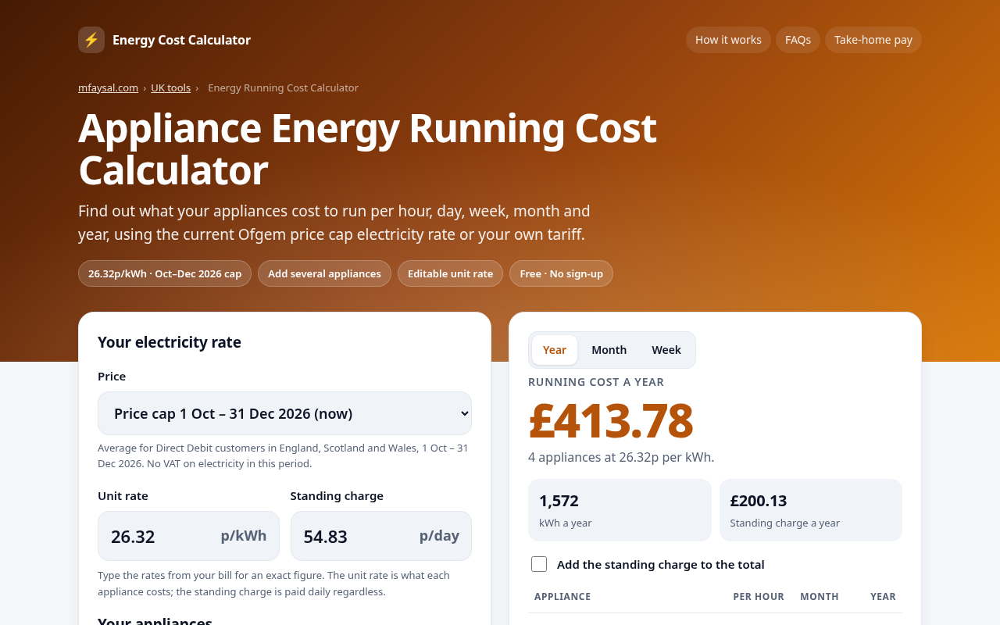

# UK Appliance Energy Running Cost Calculator

**Live:** https://uk-energy-cost-calculator.vercel.app
**Project page:** https://mfaysal.com/projects/uk-energy-cost-calculator

How much does it cost to run a kettle, heater or tumble dryer? This calculator uses **watts × hours × unit rate**, defaulting to the **Ofgem energy price cap for 1 October – 31 December 2026: 26.32p per kWh and 54.83p a day** (Direct Debit average, England, Scotland and Wales; no VAT on electricity from 1 October 2026 to 31 March 2027). The rate is fully editable.



## Features
- Add as many appliances as you like (14 typical presets, all editable)
- Minutes a day and days a week per appliance
- Cost per hour, day, week, month and year, plus yearly kWh
- Optional standing charge
- Cap period selector (Jul–Sep 2026 and Oct–Dec 2026) or your own tariff
- Chart of what costs the most and a cost-per-hour table by wattage
- Shareable URLs carry your appliance list
- Accessible (labels, keyboard, live regions), dark mode, no tracking, no cookies, no API keys
- SEO: canonical, Open Graph/Twitter card, `WebApplication` + `FAQPage` + `BreadcrumbList` JSON-LD, sitemap, robots.txt

## Tech
Plain HTML, CSS and JavaScript (ES modules), no build step and no dependencies. The calculation lives in [`public/energy.js`](public/energy.js) and is unit-tested (9 tests):

```bash
npm test   # node --test
```

| Test case | |
|---|---|
| Ofgem cap 1 Oct – 31 Dec 2026: 26.32p/kWh, 54.83p a day (Direct Debit average) | ✅ |
| 1,000 W for 1 hour = 1 kWh = 26.32p | ✅ |
| 3 kW kettle for 4 minutes = 0.2 kWh = 5.264p | ✅ |
| 2 kW heater, 3 hours a day, every day | ✅ |
| Days per week scale the weekly cost | ✅ |
| Totals add up across appliances | ✅ |
| Zero or blank input costs nothing | ✅ |
| Standing charge for a year | ✅ |
| Cap periods are in date order with no gaps | ✅ |

## Sources (checked 8 October 2026)
- [Ofgem: Energy price cap standing charges and unit rates by region](https://www.ofgem.gov.uk/information-consumers/energy-advice-households/get-energy-price-cap-standing-charges-and-unit-rates-region)
- [Ofgem: Energy price cap explained](https://www.ofgem.gov.uk/information-consumers/energy-advice-households/energy-price-cap)

> **Disclaimer:** estimates based on the power rating you enter and Ofgem’s average Direct Debit rate. Your region, tariff, meter and payment method change the real rate.

## Author
Built by **[Mahir Faysal](https://mfaysal.com)**, a web developer making free tools for the UK and Bangladesh.
- Website and blog: [mfaysal.com](https://mfaysal.com)
- All free tools: [mfaysal.com/uk-tools](https://mfaysal.com/uk-tools)
- Also try the [Take-Home Pay Calculator](https://take-home-pay-calculator-uk.vercel.app), [Hourly to Salary Calculator](https://uk-hourly-salary-calculator.vercel.app), [Redundancy Pay Calculator](https://uk-redundancy-pay-calculator.vercel.app) and [Holiday Entitlement Calculator](https://uk-holiday-entitlement-calculator.vercel.app), plus Bangladesh tools: [Bangladesh Income Tax Calculator](https://bangladesh-income-tax-calculator.vercel.app), [Electricity Bill Calculator](https://bangladesh-electricity-bill-calculator.vercel.app) and [bKash, Nagad & Rocket Charge Calculator](https://bkash-nagad-rocket-charge-calculator.vercel.app)

MIT licensed.
